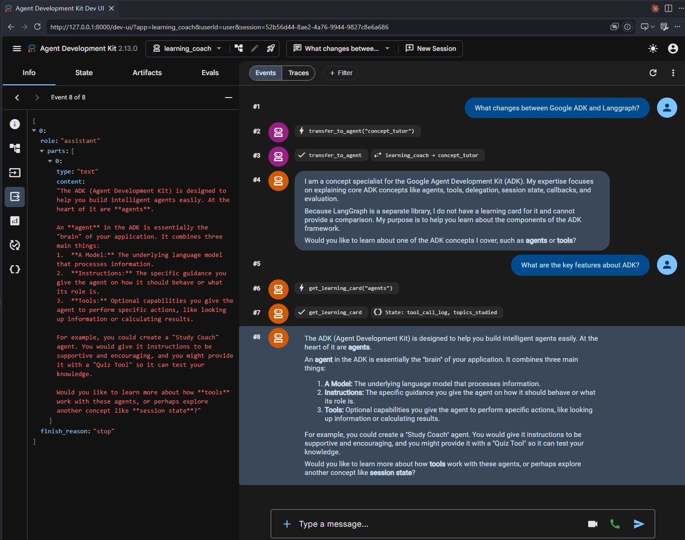
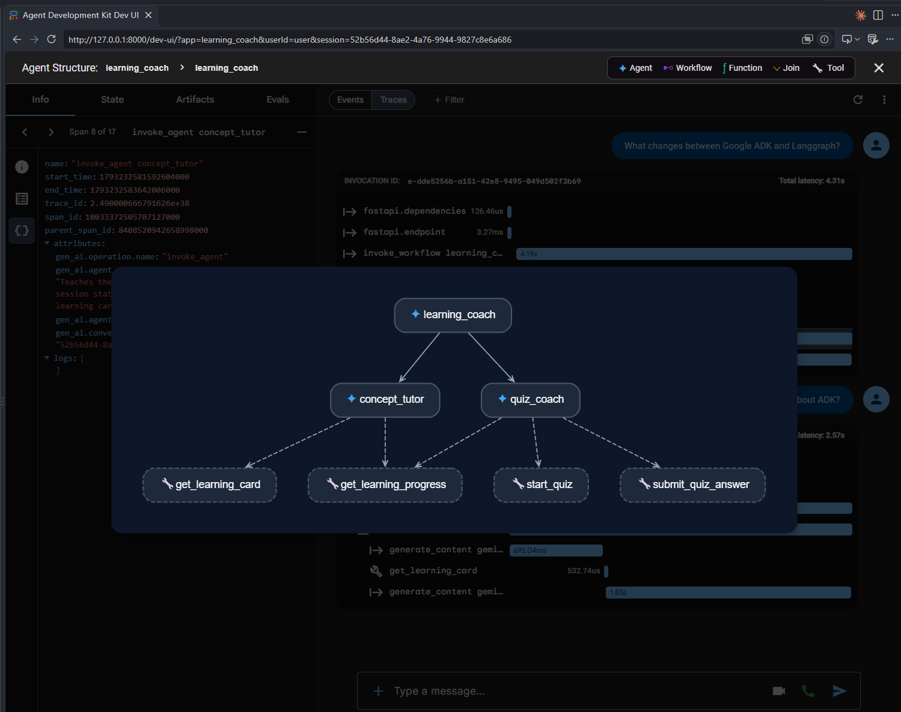
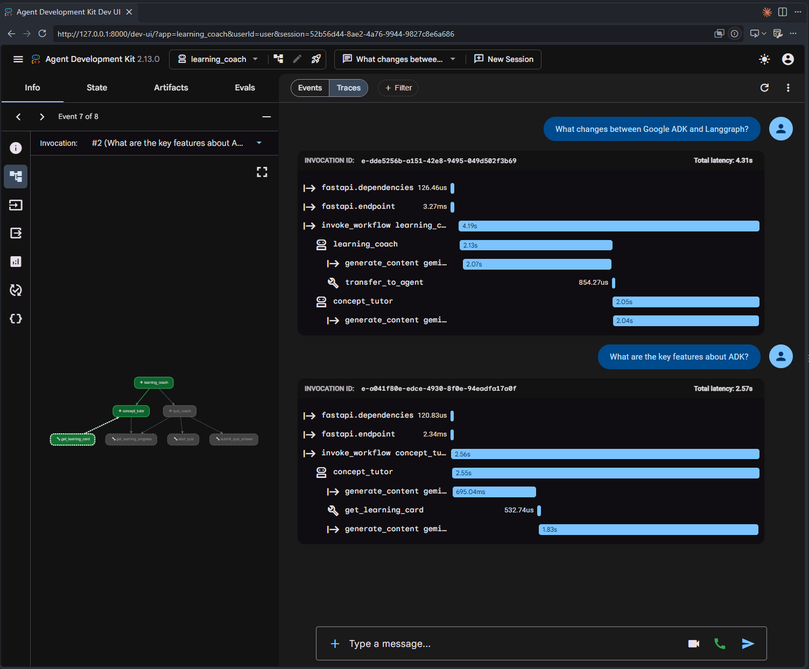
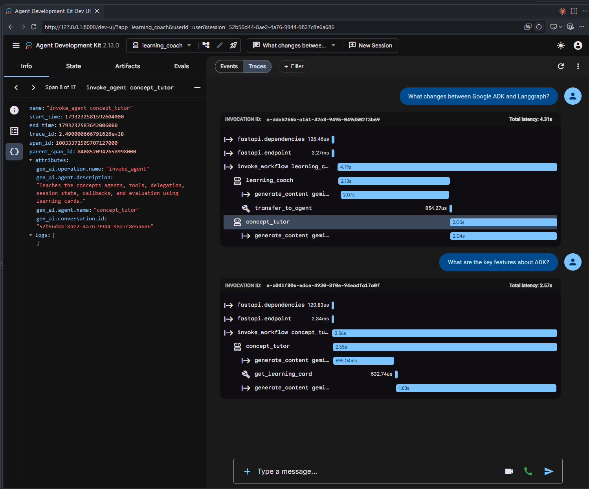
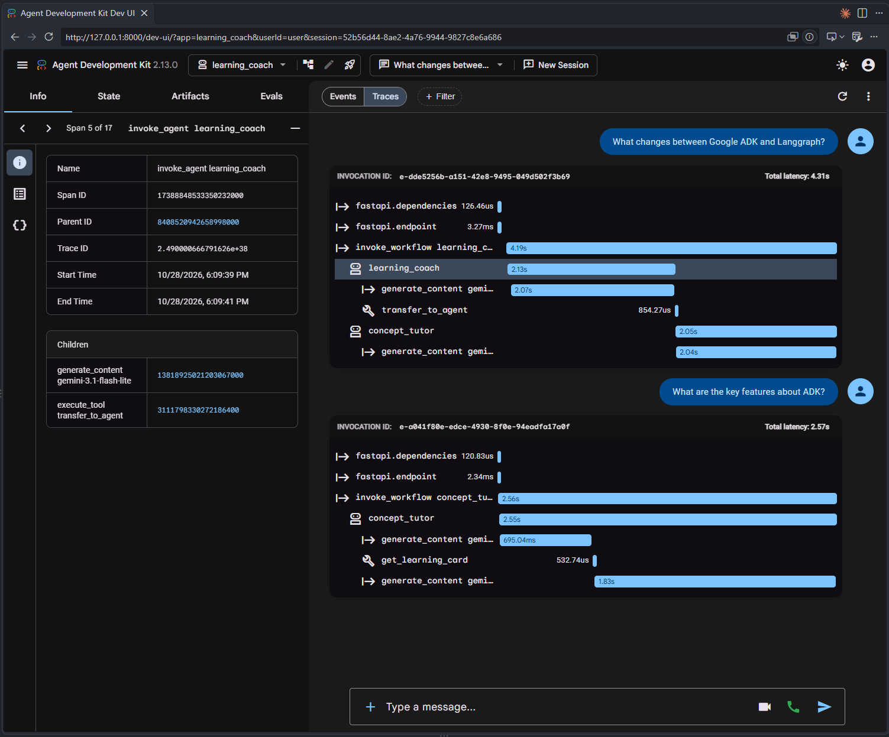
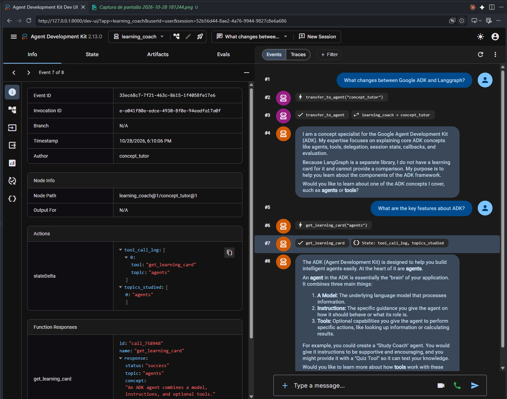
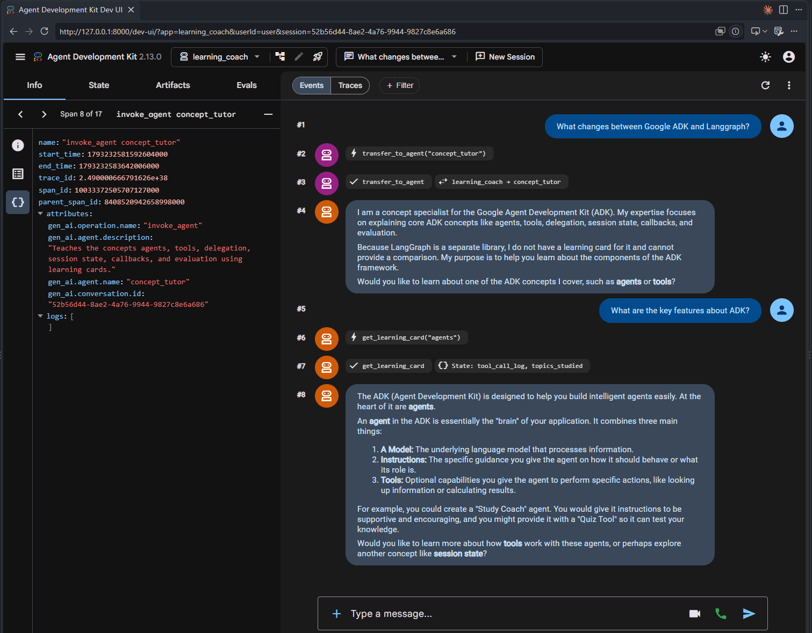
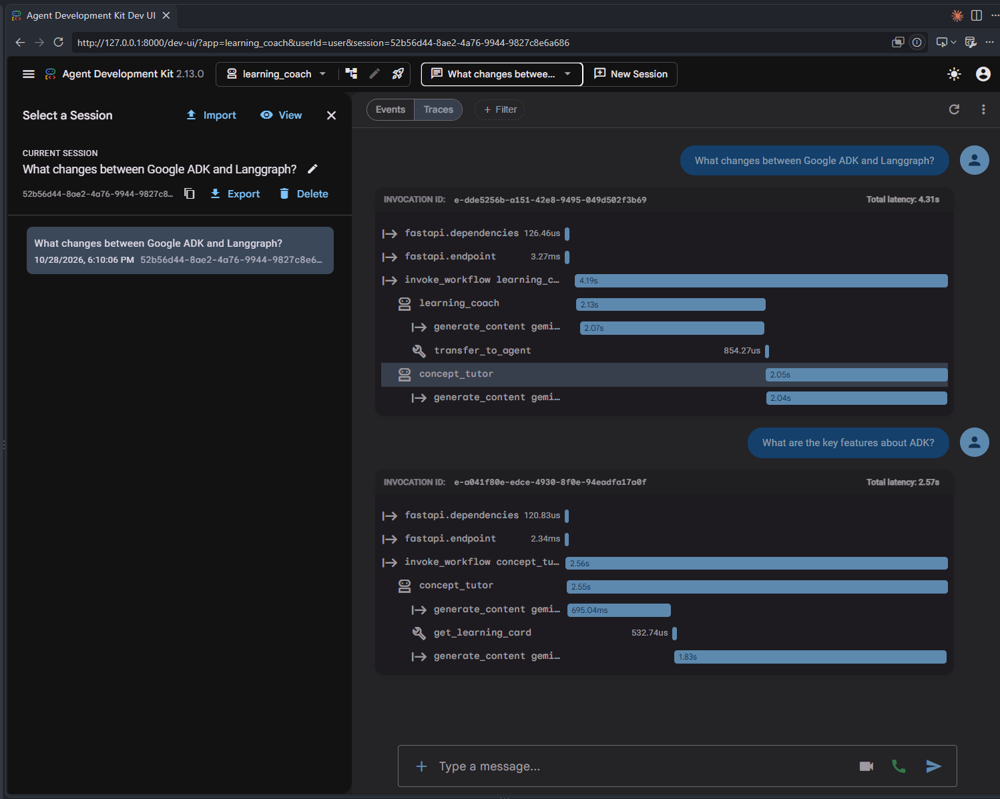
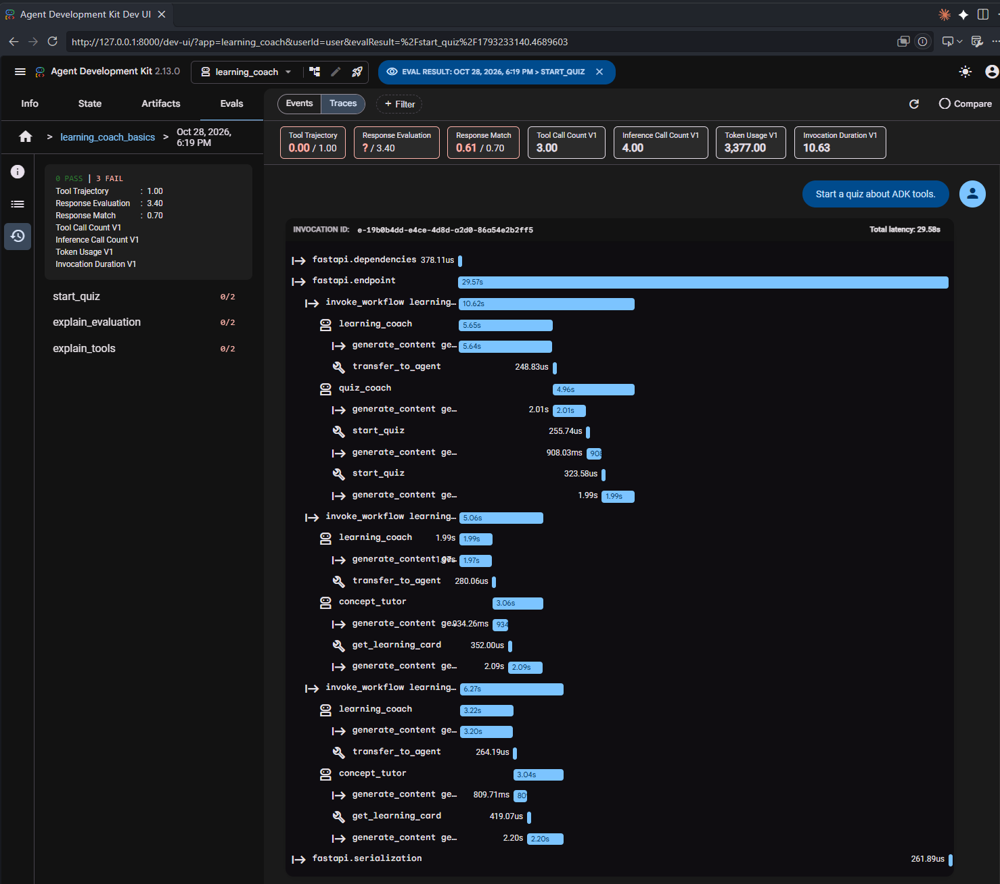

# Google ADK Learning Lab

A hands-on Python project for learning what Google's official Agent Development Kit (ADK) can do. The exercise grows a single-agent demo into a stateful, multi-agent learning coach and evaluates its behavior with ADK's evaluation framework.

## Contents

- [Learning exercise and implemented features](#learning-exercise-and-implemented-features)
- [Requirements](#requirements)
- [Installation](#installation)
- [Glossary](#glossary)
- [Ways to work with the ADK agent](#ways-to-work-with-the-adk-agent)
  - [Prompt-based terminal chat](#1-explore-with-prompt-based-terminal-chat)
  - [ADK Web development UI](#2-explore-and-debug-with-adk-web)
  - [Automated evaluation](#3-automate-repeatable-checks-with-an-adk-eval-set)
- [Understanding and extending evaluations](#understanding-and-extending-evaluations)
  - [Eval-set structure](#how-adk-expects-the-eval-set-to-be-structured)
  - [Match eval data to the evaluation goal](#match-the-eval-data-to-the-evaluation-goal)
  - [Interpreting saved results](#what-the-saved-result-tells-you)
  - [Other ADK evaluation criteria](#other-adk-evaluation-criteria-to-explore)
  - [Choosing what to measure](#how-to-choose-what-to-measure)
- [Ideas for extending this learning repository](#ideas-for-extending-this-learning-repository)
- [Run the local tests](#run-the-local-tests)
- [Project structure](#project-structure)
- [Wins](#wins)
- [Limitations](#limitations)
- [ADK Web screenshots](#adk-web-screenshots)

## Learning exercise and implemented features

The exercise is organized around these ADK capabilities:

1. **LLM agents and instructions** — expose a `root_agent` and use clear descriptions and instructions to guide behavior.
2. **Function tools and `ToolContext`** — define typed Python tools, access ADK's injected context, and read/write session state.
3. **Multi-agent delegation** — use a coordinator with focused sub-agents, an ADK concept tutor and quiz coach; let ADK transfer control to the appropriate specialist.
4. **Session state** — keep track of the current quiz and topics studied so the agent can continue a learning session instead of treating every turn as unrelated.
5. **Tool callbacks and guardrails** — inspect tool calls before execution, reject unsupported requests safely, and make the decision visible to the agent.
6. **Official ADK evaluation** — use an `.evalset.json` dataset and `test_config.json` to check both expected tool trajectories and reference-answer similarity.
7. **ADK developer tools** — run the agent with `adk run`, inspect conversations with `adk web`, and execute evaluations with `adk eval`.

The core capabilities above are implemented. The suggested extensions below are intentionally separate follow-up exercises. Code-level tests cover deterministic tool/state behavior and ADK schemas. Model-backed evaluation is a separate step, since it needs credentials and makes model calls.

## Requirements

- Python 3.11 or later
- A Google AI Studio API key for running the agent or model-backed evaluation
- Internet access for model calls
- The configured model is Gemini 3.1 Flash-Lite, selected as a lower-cost model for this learning agent.

The project installs `google-adk[eval]`, including the official ADK evaluation dependencies.

The shared model ID is in [learning_coach/config.py](./learning_coach/config.py), so the coordinator and both specialists stay on the same model. Flash-Lite is less capable than Gemini Flash for complex reasoning, but supports the function calling this exercise uses. Quotas are assigned per project and model, so switching models does not guarantee higher request limits.

## Installation

From the project root, create and activate a virtual environment, then install the project:

```powershell
python -m venv .venv
.\.venv\Scripts\Activate.ps1
python -m pip install -U pip
python -m pip install -e ".[dev]"
```

Set up the Gemini API key. Copy the example file and replace the placeholder with your key:

```powershell
Copy-Item learning_coach\.env.example learning_coach\.env
```

The `.env` file is ignored by Git. Never commit API keys.

## Glossary

These are the main terms used in the code, ADK interface, and evaluation files in this repository.

| Term | Meaning in this repository |
|---|---|
| **ADK (Agent Development Kit)** | Google's framework used here to define, run, inspect, and evaluate the learning coach. |
| **Agent** | A model-driven component with a name, instructions, and optional tools or sub-agents. The root agent coordinates the learning coach. |
| **Root agent** | The top-level `learning_coach` agent. It receives the user's request and can answer or delegate work to a specialist. |
| **Sub-agent / specialist** | An agent attached to a parent agent for a focused responsibility. `concept_tutor` teaches concepts; `quiz_coach` runs quizzes. |
| **Delegation / handoff** | The root agent transfers a request to a sub-agent. In traces this can appear as `transfer_to_agent`; it is part of the tool trajectory when a test expects it. |
| **Model** | The language model an agent uses to interpret requests and produce responses. This project configures Gemini 3.1 Flash-Lite in `learning_coach/config.py`. |
| **Instruction** | Natural-language guidance that defines an agent's role, when to use tools, and how to respond. It is different from a user's prompt. |
| **Tool / function tool** | A callable function an agent can use to perform application logic or retrieve data. Examples here include `get_learning_card` and `start_quiz`. |
| **Tool call** | An agent's request to run a tool, including its name and arguments. A tool call is distinct from the tool's returned response. |
| **`ToolContext`** | ADK's context object injected into a tool. This project uses it to read and update the current session's state. |
| **Callback** | A function ADK runs around an agent, model, or tool lifecycle step. The `before_tool_callback` here logs tool calls and blocks unsupported topics. |
| **Guardrail** | A check that constrains behavior. The topic guardrail blocks unsupported learning-card and quiz requests before those tools run. |
| **Session** | The conversation context used to group turns for a user. A session lets the agent continue a quiz or remember topics within the configured session service. |
| **Session state** | Key-value data associated with a session. This project stores values such as `current_quiz`, `topics_studied`, and `quiz_score`. |
| **Eval set** | A collection of evaluation cases, stored here in `learning_coach/learning_coach_basics.evalset.json`. It defines test scenarios and expected behavior, not scoring thresholds. |
| **Eval case** | One named scenario in an eval set, identified by `eval_id`. It can contain a fixed conversation or a simulated conversation scenario, plus optional initial state and rubrics. |
| **Conversation / invocation** | A conversation is the ordered sequence in an eval case; each invocation is one user-to-agent turn with input and optional expected outputs/tool activity. |
| **Reference response** | The expected final answer recorded in an eval invocation. Response metrics compare the agent's answer with it; it does not necessarily require identical wording. |
| **Expected tool trajectory** | The ordered tool calls recorded as expectations for an invocation. ADK compares actual calls against them when tool-trajectory evaluation is enabled. |
| **Eval config / criterion** | `eval/test_config.json` chooses which quality checks to run and their thresholds or options. ADK calls these checks criteria; some efficiency values are reported automatically. |
| **Threshold / score** | A score measures a criterion for a case; the threshold is the minimum required for that criterion to pass. A low score can fail a case without indicating that the CLI itself crashed. |
| **Rubric** | A written description of a quality to judge, such as clarity or appropriate tool use. Rubric-based criteria use an evaluator (often an LLM judge) to score that description. |
| **LLM judge** | A model used by some evaluation criteria to judge semantic quality, safety, grounding, or rubric adherence rather than comparing only fixed text or calls. Judge results can vary and consume additional model usage. |
| **User simulation** | An evaluation mode where ADK simulates a user following a scenario and conversation plan. It is different from a fixed, authored conversation and may produce variable turns. |
| **Regression test** | A repeatable evaluation case used after changes to check whether important behavior still meets expectations. A useful suite covers representative tasks and relevant success criteria. |
| **Trace / event** | ADK's record of execution. Events represent individual messages or actions; traces group timing and execution steps to help investigate a run in ADK Web. |
| **Artifact** | A file-like object an agent can save or retrieve through ADK. Artifacts are a suggested extension for study notes; this project does not currently implement them. |

## Ways to work with the ADK agent

The repository follows ADK's agent-package convention: [learning_coach/](./learning_coach/) is the importable agent folder, [agent.py](./learning_coach/agent.py) exposes `root_agent`, and `__init__.py` makes the package discoverable by the ADK CLI. The same agent can be exercised in the terminal, explored in the browser, or evaluated against a saved test set. These are different workflows for different questions:

| Workflow | Start with | Useful when you want to... |
|---|---|---|
| Interactive terminal | `adk run learning_coach` | Try a prompt quickly, have a conversation, and see the agent's text response. |
| ADK Web development UI | `adk web --port 8000` | Chat in a browser, inspect sessions and tool events, view traces/agent flow, and run eval sets interactively. |
| Automated evaluation | `adk eval ...` | Re-run a fixed set of scenarios after a code or prompt change and compare behavior using configured metrics. |

### 1. Explore with prompt-based terminal chat

Run this from the repository root:

```powershell
adk run learning_coach
```

ADK starts an interactive terminal session. Type a user message at the `[user]:` prompt; the agent processes it and prints its response. Continue with follow-up prompts to explore a conversation, and type `exit` to leave. This is the quickest way to try open-ended prompts, but it is manual: it does not automatically compare the response against expected answers or produce a pass/fail report.

Try prompts such as:

- “Teach me what an ADK function tool is.”
- “Quiz me on tools, then tell me whether my answer is right.”
- “What topics have I studied so far?”
- “Can you teach me about a topic that is not supported?”

### 2. Explore and debug with ADK Web

Start the local development UI from the repository root:

```powershell
adk web --port 8000
```

Open `http://localhost:8000` and select `learning_coach`. Use the chat view to interact with the agent, and use the session, event, and trace views to inspect tool calls, state changes, agent handoffs, and model activity. ADK Web can also discover this repository's eval set and run it from its **Eval** tab. This is useful when you want to see *how* an individual run happened or inspect failures visually.

ADK Web is a local development and debugging interface, not a production deployment. A browser chat is still an interactive conversation; it is not automatically a regression test just because it happened in the UI.

### 3. Automate repeatable checks with an ADK eval set

An evaluation run is different from chatting with the agent. ADK reads prewritten scenarios from [learning_coach/learning_coach_basics.evalset.json](./learning_coach/learning_coach_basics.evalset.json), runs the agent on those inputs, and compares actual behavior with the expectations in each case. The eval set supplies the scenarios and reference data; [eval/test_config.json](./eval/test_config.json) supplies the pass/fail criteria and thresholds. The CLI and ADK Web's Eval tab can use the same eval set and criteria.

Run the evaluation from the repository root:

```powershell
adk eval learning_coach learning_coach/learning_coach_basics.evalset.json --config_file_path eval/test_config.json --print_detailed_results
```

For each case, the eval set can describe user turns, expected final responses, expected tool calls, and initial session state. ADK executes the real agent and compares what it did with that test data. In this repository, the configured checks are exact tool-trajectory matching and ROUGE-1 response similarity. A case fails if an enabled criterion falls below its threshold; a failure is a test result to investigate, not necessarily a crash in ADK. The model still generates responses during evaluation, so runs can take time, consume quota, and vary.

ADK prints the detailed report and saves structured `.evalset_result.json` output under `learning_coach/.adk/eval_history/`. Review the newest result to see expected versus actual invocations, response text, metric scores, and efficiency data. The local `.adk` directory is generated and Git-ignored. See [Understanding and extending evaluations](#understanding-and-extending-evaluations) for how to read the eval set, choose criteria, and add scenarios.

**Which workflow should I choose?**

- **“What does the agent do with this prompt?”** Use `adk run` for a quick terminal conversation.
- **“Why did it call that tool or delegate to that agent?”** Use ADK Web to inspect events and traces.
- **“Did my change preserve expected behavior across known scenarios?”** Run `adk eval` to test the saved cases consistently.
- **“Do I need all three?”** A practical learning loop is: experiment in the terminal, inspect/debug in ADK Web, then run evals to check known behavior after making changes.

## Understanding and extending evaluations

The evaluation dataset in [learning_coach/learning_coach_basics.evalset.json](./learning_coach/learning_coach_basics.evalset.json) contains conversations with reference responses and expected tool calls. Its criteria are configured in [eval/test_config.json](./eval/test_config.json).

The eval set is stored in the `learning_coach` agent folder as [learning_coach_basics.evalset.json](./learning_coach/learning_coach_basics.evalset.json), which lets ADK Web discover it in the **Eval** tab. Run the same dataset with the official ADK CLI:

```powershell
adk eval learning_coach learning_coach/learning_coach_basics.evalset.json --config_file_path eval/test_config.json --print_detailed_results
```

### How ADK expects the eval set to be structured

The eval set is test data; it is separate from the metric thresholds in [eval/test_config.json](./eval/test_config.json). The real [learning_coach/learning_coach_basics.evalset.json](./learning_coach/learning_coach_basics.evalset.json) must remain valid JSON. **JSON does not support comments**: adding `//` or `/* ... */` to that file makes it invalid for normal JSON parsers and ADK. The JSONC example below is therefore an annotated teaching template, not a file to pass directly to `adk eval`. Remove its comments before saving an eval set as `.evalset.json`.

```jsonc
{
  // Stable identifier for this eval set; ADK Web and result history use it.
  "eval_set_id": "learning_coach_basics",

  // Human-readable label and purpose; these do not define scoring behavior.
  "name": "Learning Coach ADK Basics",
  "description": "Checks tool use and response quality for introductory ADK concepts.",

  // ADK runs each case independently with its own conversation/session setup.
  "eval_cases": [
    {
      // Unique, descriptive identifier for this regression scenario.
      "eval_id": "explain_tools",

      // Use exactly ONE of `conversation` (fixed, authored turns) OR
      // `conversation_scenario` (a user-simulator scenario), never both.
      "conversation": [
        {
          // Stable identifier for this turn inside the conversation.
          "invocation_id": "learning-coach-tools-001",

          // The user input ADK sends to the real agent.
          "user_content": {
            "parts": [{"text": "Explain what tools are in Google ADK."}],
            "role": "user"
          },

          // Reference final answer. Used by reference-based response metrics;
          // it does not force the agent to return this exact wording.
          "final_response": {
            "parts": [{"text": "ADK function tools let an agent call Python functions."}],
            "role": "model"
          },

          "intermediate_data": {
            // Expected function/tool calls and arguments, in chronological
            // order. `tool_trajectory_avg_score` compares actual calls to these.
            "tool_uses": [
              {"name": "get_learning_card", "args": {"topic": "tools"}}
            ],

            // Optional expected tool responses or non-final agent responses.
            // Populate these only when the chosen evaluation needs them.
            "tool_responses": [],
            "intermediate_responses": []
          }

          // Optional per-turn rubrics can be attached here. Each rubric uses
          // rubric_id and rubric_content.text_property. Rubric-based metrics
          // must also be enabled in test_config.json.
        }
      ],

      // Starting state for this case. Set state keys when testing behavior
      // that depends on prior session data; an empty object starts fresh.
      "session_input": {
        "app_name": "learning_coach",
        "user_id": "eval_user",
        "state": {}
      }

      // Optional case-level rubrics apply to every invocation in this case.
      // Example:
      // "rubrics": [
      //   {
      //     "rubric_id": "clear_explanation",
      //     "rubric_content": {
      //       "text_property": "The answer explains the concept clearly for a beginner."
      //     },
      //     "description": "Judge clarity and beginner accessibility.",
      //     "type": "FINAL_RESPONSE_QUALITY"
      //   }
      // ]
    }
  ]
}
```

In the real eval set, every field has a role in describing **what to run** or **what to compare**:

| Field | What ADK uses it for |
|---|---|
| `eval_set_id` | Identifies the set in local storage and ADK Web. Keep it stable when adding cases to the same set. |
| `name`, `description` | Human-readable title and purpose; they do not enable metrics. |
| `eval_cases` | The collection of independent test scenarios ADK runs. |
| `eval_id` | Names a case in reports so you can identify a regression. Keep it unique within the set. |
| `conversation` | A fixed, authored list of invocation turns. Use this for reproducible regression tests with known user messages and expected behavior. |
| `conversation_scenario` | An alternative to `conversation`: `starting_prompt`, `conversation_plan`, and optional `user_persona` define a goal for a simulated user. Configure the simulator in the eval config. Useful for exploring multi-turn paths that are not one fixed script, but simulated turns can vary. |
| `invocation_id` | Identifies one turn in an authored conversation. Use stable IDs to make failures easier to compare across runs. |
| `user_content` | The prompt sent to the agent. This is the input whose behavior the test exercises. |
| `final_response` | Reference output for response-based criteria such as `response_match_score` and `final_response_match_v2`. Provide one when you want reference-based scoring; these metrics score similarity rather than requiring byte-for-byte identical text. |
| `intermediate_data.tool_uses` | Expected tool/function calls and arguments. Needed for `tool_trajectory_avg_score`; `EXACT` also treats extra calls (for example, an unlisted `transfer_to_agent`) as a mismatch. |
| `intermediate_data.tool_responses` | Expected tool outputs, when a test or metric needs to describe tool results. |
| `intermediate_data.intermediate_responses` | Expected non-final natural-language responses, such as specialist responses in a multi-agent flow. |
| `session_input` | Initializes app/user/session identity and state for the case. Use `state` to seed a stateful test. |
| `rubrics` | Optional case-level quality criteria copied to its turns; invocation-level rubrics can target an individual turn. Rubric-based evaluation metrics require rubrics and an LLM judge. |

For static multi-turn regression tests, put multiple turns in `conversation` in order. Each turn can have its own prompt, reference response, expected calls, and rubric. For a simulated conversation, use `conversation_scenario` instead of `conversation` and configure `user_simulator_config` in the evaluation config. Do not mix the two modes in one case.

### Match the eval data to the evaluation goal

The eval file and metric configuration work together: the eval set provides the evidence and scenarios; `test_config.json` chooses which criteria score that evidence. Use the existing [built-in criteria table](#other-adk-evaluation-criteria-to-explore) as a catalog, and use this quick guide when designing cases:

| Goal | Put this in the eval set | Enable in the config |
|---|---|---|
| Prevent regressions in known final answers | Fixed `conversation` turns with representative `user_content` and reference `final_response` | `response_match_score` for word overlap or `final_response_match_v2` for LLM-judged semantic matching |
| Ensure critical tools are called with correct arguments | `intermediate_data.tool_uses` for each relevant turn; include all expected handoffs when requiring an exact trajectory | `tool_trajectory_avg_score`; choose `EXACT`, `IN_ORDER`, or `ANY_ORDER` to match intended behavior |
| Assess clarity, correctness, or instruction-following without one canonical answer | Case-level or turn-level `rubrics` describing observable qualities | `rubric_based_final_response_quality_v1` and/or other matching rubric-based criteria |
| Check that answers stay grounded in retrieved content | Representative prompts and available grounding evidence, such as relevant tool responses/context | `hallucinations_v1` |
| Check safety behavior | Representative safe and unsafe prompts with the intended safe behavior | `safety_v1` |
| Check end-to-end goals or broader conversation behavior | Multi-turn `conversation` with explicit turns, or `conversation_scenario` plus user-simulator configuration | Relevant `multi_turn_*` criteria; simulation-aware criteria when using scenarios |
| Track efficiency and spot regressions in cost or latency | Normal representative cases; no special expected output is needed | ADK always reports `tool_call_count_v1`, `inference_call_count_v1`, `token_usage_v1`, and `invocation_duration_v1` as informational metrics |

No single eval set needs every kind of case. Build a regression suite around important user tasks, keep cases focused enough that a failure explains what broke, and add separate scenarios for safety, grounding, state, and multi-turn behavior when those are requirements. Reference-based checks are often easier to interpret and automate; judge-based checks can assess qualities that are hard to express as fixed expected output, but can vary and may add latency, quota use, and cost. Always review traces and failed examples rather than treating an aggregate score as proof of correctness.

The `.evalset.json` filename convention and location inside `learning_coach/` allow ADK Web to discover this set. When editing the real dataset, remove any JSONC comments, keep it valid JSON, and run `python -m pytest -q`; the project tests validate the file against ADK's `EvalSet` schema and verify local discovery.

ADK prints the detailed report in the terminal and automatically saves each run as a structured JSON file in `learning_coach/.adk/eval_history/`. This is ADK's native result format; the latest run is the `.evalset_result.json` file with the newest timestamp. The `.adk` folder is generated locally and excluded from Git. A non-zero exit code means one or more evaluation criteria failed; ADK still saves the result JSON for that run.

The CLI does not provide an option to choose a local output filename. Its `--eval_storage_uri` option is for storing evals in a Google Cloud Storage bucket (`gs://...`), not for writing to an arbitrary local path.

The run uses two ADK metrics:

- `tool_trajectory_avg_score` compares actual tool calls with the calls in the eval case. The current `EXACT` match type requires every call to match exactly, with no extras.
- `response_match_score` uses ROUGE-1 word overlap to compare the final response with the reference. It is not a semantic correctness check, so a correct answer worded differently can score poorly.

Model-backed evaluation requires the API key. It may incur model usage costs.

### What the saved result tells you

Each `.evalset_result.json` includes the expected and actual invocation data, final responses, metric scores and statuses, and per-invocation efficiency information. Use it to answer questions such as:

- Did the answer resemble the reference closely enough?
- Did the agent call the expected tool, with the expected arguments?
- How many tools and model calls did the invocation use?
- How many tokens did it consume, and how long did it take?

The ADK Web **Eval** view makes it easier to compare passing and failing cases; the **Trace** view can help inspect the agent and tool execution behind a run. These explain what happened, but do not by themselves establish that an answer is factually correct.

### Other ADK evaluation criteria to explore

The current [test configuration](./eval/test_config.json) enables two pass/fail criteria. ADK also supports the following built-in criteria. A criterion only provides useful evidence when the eval data contains what it needs; some also make additional LLM-judge calls.

| Criterion | What it evaluates | What the eval needs |
|---|---|---|
| `tool_trajectory_avg_score` | Whether actual tool calls match the expected tool-call trajectory. Supports `EXACT`, `IN_ORDER`, and `ANY_ORDER` matching. | Expected tool calls; choose a match type that reflects the behavior you want to test. |
| `response_match_score` | ROUGE-1 word overlap between the actual and reference response. | A reference response for each case. |
| `final_response_match_v2` | LLM-judged semantic similarity to a reference answer. | A reference response; uses a judge model and may add model cost. |
| `response_evaluation_score` | Vertex AI evaluation of response coherence. | Vertex AI evaluation setup and suitable reference/evaluation data. |
| `rubric_based_final_response_quality_v1` | LLM-judged final-answer quality against criteria you define, such as accuracy, clarity, or helpfulness. | Rubrics that describe a good answer; an LLM judge. |
| `rubric_based_tool_use_quality_v1` | Whether tool use is relevant and follows your quality criteria. | Tool-use rubrics; an LLM judge. |
| `rubric_based_multi_turn_trajectory_quality_v1` | Whether a multi-turn execution follows a desired trajectory. | A multi-turn scenario and trajectory rubrics; an LLM judge. |
| `hallucinations_v1` | Whether answer claims are supported by, or contradict, the available context. | Grounding context, such as tool results; an LLM judge. |
| `safety_v1` | Whether the response meets safety and harmlessness expectations. | Representative safety test cases; an evaluator/judge. |
| `multi_turn_task_success_v1` | Whether the agent achieved the goal of the full conversation. | A multi-turn conversation with a clearly stated goal; an LLM judge. |
| `multi_turn_trajectory_quality_v1` | The overall effectiveness and logic of the conversation trajectory. | A multi-turn conversation; an LLM judge. |
| `multi_turn_tool_use_quality_v1` | The quality and correctness of tool use across a conversation. | A multi-turn conversation with relevant tool-use context; an LLM judge. |
| `per_turn_user_simulator_quality_v1` | The quality of user-simulator turns in simulated conversations. | A user-simulated multi-turn evaluation; an LLM judge. |

ADK also reports these **informational efficiency metrics automatically** for each evaluation; they are not pass/fail criteria and do not need to be added to `test_config.json`:

| Metric | What it reports |
|---|---|
| `tool_call_count_v1` | Number of tool calls. |
| `inference_call_count_v1` | Number of model calls. |
| `token_usage_v1` | Token usage, including available input/output breakdowns. |
| `invocation_duration_v1` | Total invocation time, with available model, tool, and framework breakdowns. |

### How to choose what to measure

The right criteria depend on the behavior you want to verify and what each eval case records:

- For stable regression checks of known prompts, keep a small reference answer and expected tool calls. Use `response_match_score` and `tool_trajectory_avg_score`.
- If correct wording can vary, consider `final_response_match_v2` rather than relying only on word overlap. It uses a model judge, so review its settings and cost.
- If an answer must satisfy a quality standard without one exact reference answer, write a rubric and try `rubric_based_final_response_quality_v1`.
- To test answers grounded in retrieved learning content, include relevant context/tool responses in cases and explore `hallucinations_v1`.
- To test a workflow, create multi-turn cases that include the goal, intermediate turns, and expected behavior, then explore the multi-turn criteria.
- For efficiency regressions, compare the automatic token, call-count, and duration metrics across runs.

This repository's current eval set has three single-turn examples, each with a reference response and expected tool call. That makes the first two criteria applicable, but it does not yet provide a meaningful multi-turn task-success test, a safety-focused suite, or broad hallucination coverage. Add cases for those behaviors before enabling the related criteria. LLM-judged metrics can be probabilistic and may require additional model configuration, API access, time, and cost. See the [official ADK evaluation criteria guide](https://google.github.io/adk-docs/evaluate/criteria/) and [custom metrics guide](https://google.github.io/adk-docs/evaluate/custom_metrics/) for current setup details.

## Ideas for extending this learning repository

These are follow-up exercises, not features currently implemented:

- **Improve evaluation design:** Decide whether evals should expect coordinator handoffs as well as specialist tool calls; compare `EXACT` with `IN_ORDER` matching; add examples for unsupported topics, quiz answers, and session progress.
- **Explore quality metrics:** Add reference answers or rubrics, then try semantic response matching, response-quality rubrics, or groundedness checks. Keep metric configuration with the eval data and compare results across runs.
- **Add multi-turn evaluations:** Test a complete learning flow, such as starting a quiz, answering incorrectly, receiving a hint, retrying, and checking the score.
- **Add safety-focused cases:** Include representative unsupported or unsafe requests and define the expected safe behavior before evaluating `safety_v1`.
- **Try workflow agents:** Use `SequentialAgent`, `ParallelAgent`, or `LoopAgent` to contrast deterministic orchestration with the coordinator's current LLM-directed delegation.
- **Use artifacts:** Have an agent create and retrieve durable learning notes or study plans.
- **Connect trusted information:** Add a built-in or MCP tool that searches official ADK documentation rather than relying only on the bundled learning cards.
- **Experiment with callbacks:** Add model/agent callbacks for tracing, policy enforcement, or modifying execution around model and tool steps.
- **Add durable sessions and deployment:** Replace local in-memory development services with persistence and deploy the agent beyond the local ADK Web UI.

## Run the local tests

These tests verify the agent configuration and tool behavior without calling a model:

```powershell
python -m pytest -q
```

## Project structure

```text
.
├── .gitignore
├── .vscode/
│   └── settings.json               # VS Code Python test configuration
├── assets/                         # Screenshots embedded in this README
│   ├── agent-response.png
│   ├── evals.png
│   ├── graph.png
│   ├── invocation-graph-view.png
│   ├── invoke-subagent-raw-json.png
│   ├── raw-json.png
│   ├── select-session.png
│   ├── tool-usage.png
│   └── traces-info.png
├── eval/
│   ├── results/                    # Local, generated evaluation output (ignored)
│   │   └── learning_coach_eval_results.txt # Existing captured CLI log, if present
│   └── test_config.json            # ADK evaluation criteria and thresholds
├── learning_coach/                 # ADK-discoverable agent package
│   ├── .adk/                       # Local ADK session and evaluation history (ignored)
│   │   ├── eval_history/
│   │   │   └── *.evalset_result.json # Structured result from each ADK eval run
│   │   └── session.db              # Local ADK session storage
│   ├── agents/
│   │   ├── __init__.py
│   │   ├── concept_tutor.py        # Concept specialist
│   │   └── quiz_coach.py           # Quiz specialist
│   ├── .env                        # Local API key; ignored and not committed
│   ├── .env.example                # Credentials template
│   ├── __init__.py                 # Exposes root_agent
│   ├── agent.py                    # Root coordinator
│   ├── callbacks.py                # Tool-call guardrail and logging
│   ├── config.py                   # Shared Gemini model ID
│   ├── learning_coach_basics.evalset.json # Eval set shown in ADK Web
│   └── tools.py                    # Learning, quiz, and progress tools
├── tests/
│   └── test_learning_coach.py      # Offline tests
├── pyproject.toml
└── README.md
```

The tree includes the local `.env`, `.adk` data, and evaluation log to show where they live when present; these are generated or machine-specific files and should not be committed. Evaluation history grows as runs are added, so `*.evalset_result.json` represents the generated files in that folder. The local `.venv/`, `.pytest_cache/`, and Python `__pycache__/` directories are also generated and ignored, and are omitted from the tree.

This follows the official ADK agent-package shape (`<agent>/__init__.py` and `<agent>/agent.py`) while splitting specialists, tools, callbacks, evaluation configuration, and unit tests into focused modules. The eval set itself stays beside the agent package because ADK Web discovers it there.

## Wins

- Uses the official Google ADK package and CLI rather than reimplementing agent execution or evaluation.
- Demonstrates function tools, context-aware session state, callback guardrails, and multi-agent delegation.
- Exercises both tool-use trajectories and final answers using ADK's built-in evaluation metrics.
- Keeps the lesson reproducible: local tools do not depend on external data services.
- Separates offline tests from model-backed evaluations, so tool and state behavior can be checked without API calls.

## Limitations

- Running the agent and official evaluation requires a valid Gemini API key, network access, and may incur model charges.
- Model output is probabilistic. Response matching is approximate, while exact tool matching can fail if the model changes the tool choice or arguments.
- The learning content is a small local example, not a live documentation search or a production knowledge base.
- Session-state persistence depends on the configured ADK session service; local development is not a production persistence setup.
- Automatic delegation and generated answers are probabilistic; the evaluation dataset checks a small set of scenarios, not every possible conversation.
- Workflow agents, artifacts, external MCP integrations, production deployment, and production observability remain suggested extensions rather than part of the core exercise.
- This project is an educational example, not a deployed service or a comprehensive certification of agent quality.

## ADK Web screenshots

The following screenshots are optional visual references for the ADK Web workflow described earlier. Start the UI with `adk web --port 8000` and select `learning_coach` to explore the same views.

### Agent conversation



The chat shows the coordinator handing a question to `concept_tutor`, a `get_learning_card` call, and the specialist's final explanation.

### Agent hierarchy



The graph shows `learning_coach` connected to its `concept_tutor` and `quiz_coach` sub-agents, along with their learning and quiz tools.

### Invocation and trace views



This view combines conversation events with trace timing and a compact graph highlighting the selected concept-tutor tool path.



The trace details identify the `invoke_agent concept_tutor` span and show its agent attributes, parent span, and timing metadata.



The timeline breaks an invocation into coordinator model generation, `transfer_to_agent`, and specialist execution spans.

### Tool execution and raw event data



The selected `get_learning_card` event shows its state delta (`tool_call_log` and `topics_studied`) and the function response returned to the agent.



The event details expose the underlying serialized assistant message, including its text content and finish reason.

### Session management



The session panel lists the current conversation and provides controls to import, view, export, or delete a session.

### Evaluation results



This example run shows three failed cases, the tool-trajectory and response-match scores, and the trace for a quiz request. The scores reflect that specific run and its selected thresholds; see [Understanding and extending evaluations](#understanding-and-extending-evaluations) for how to interpret them.
