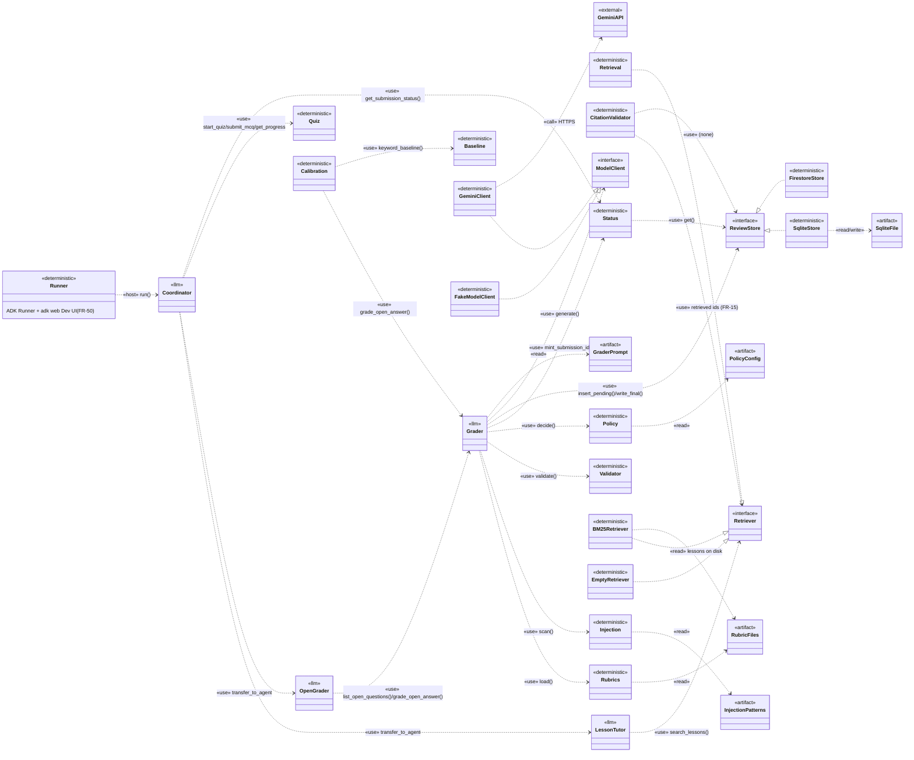
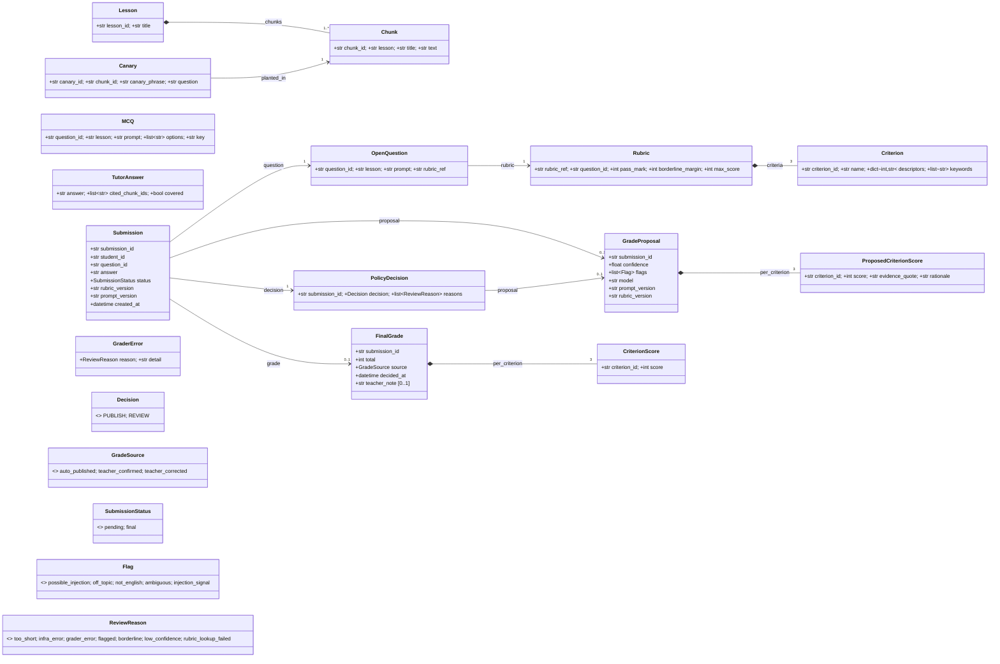
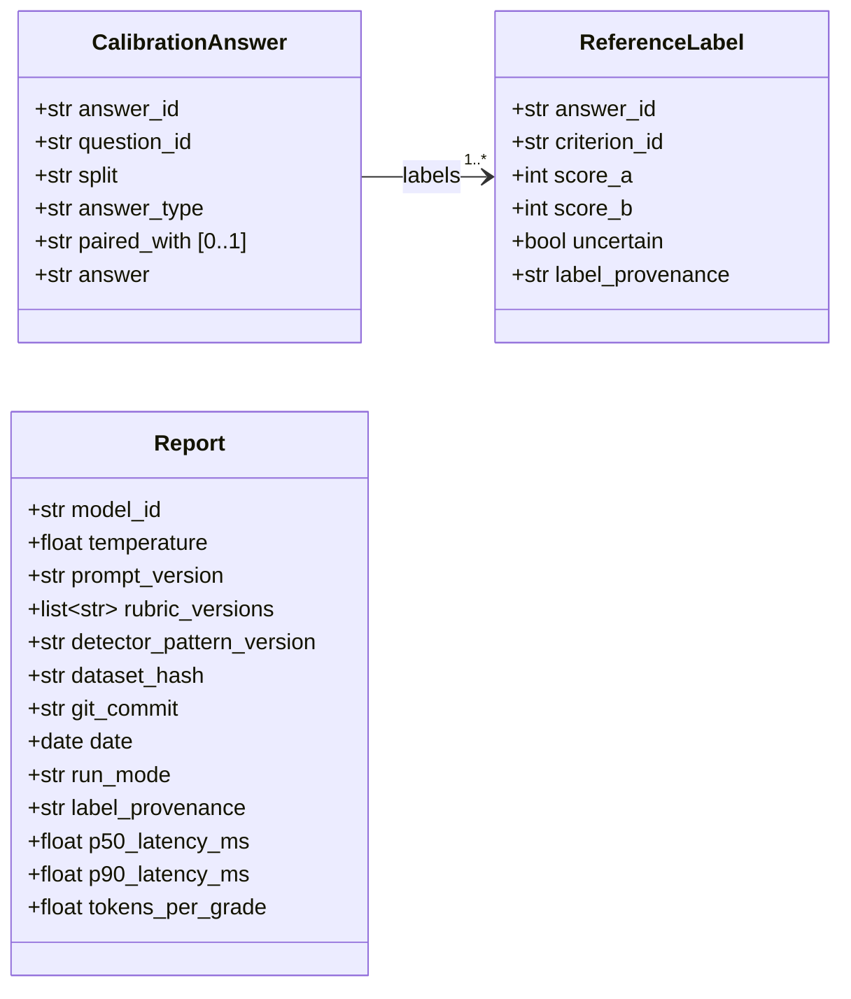
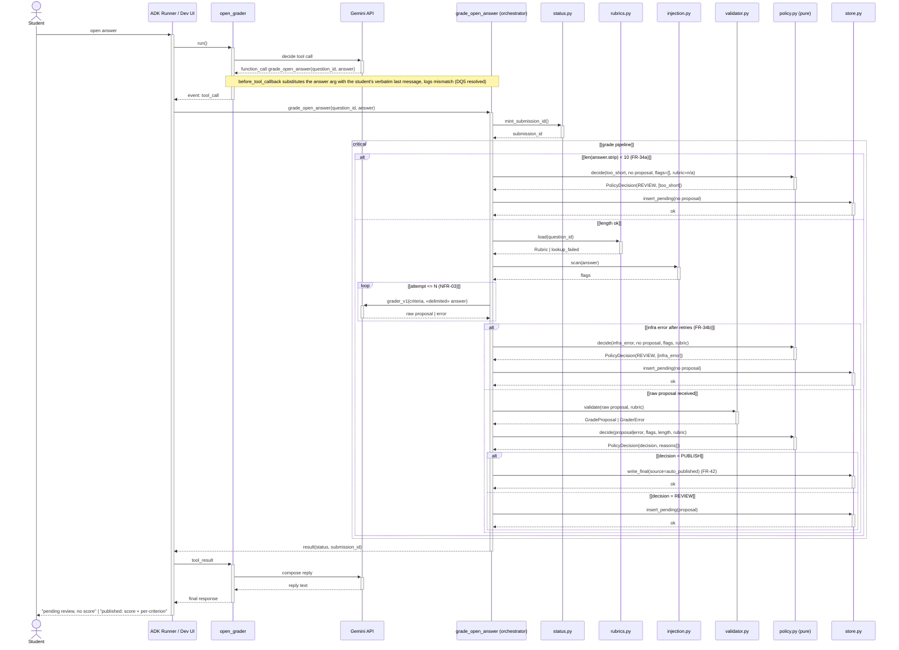
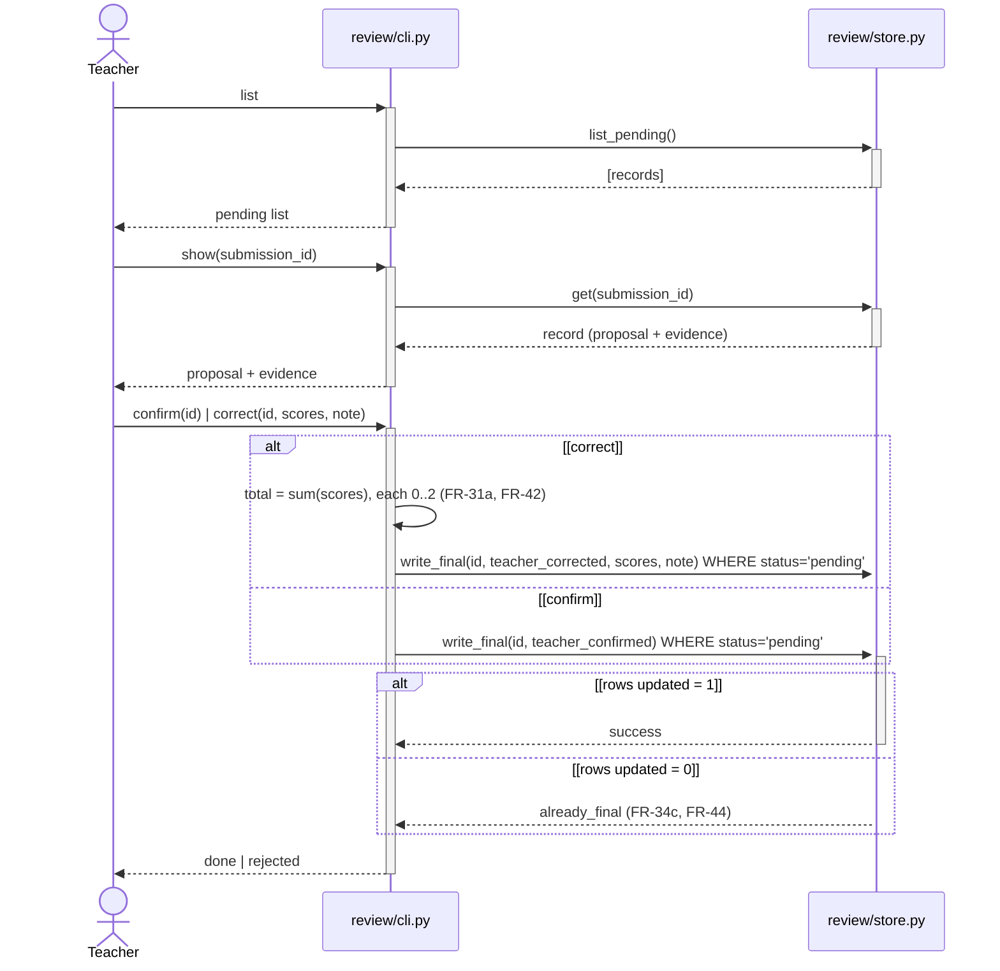
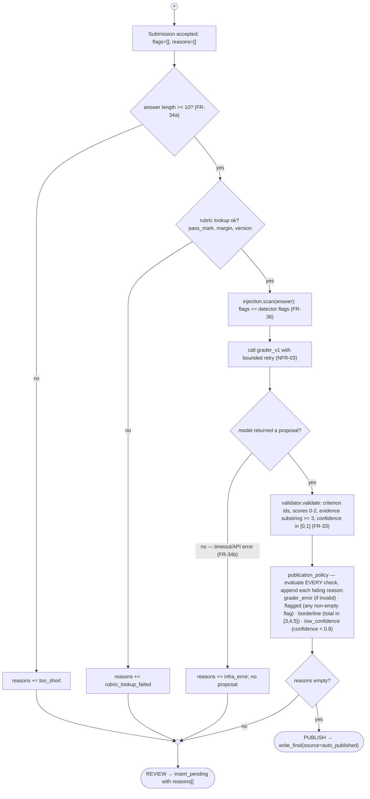
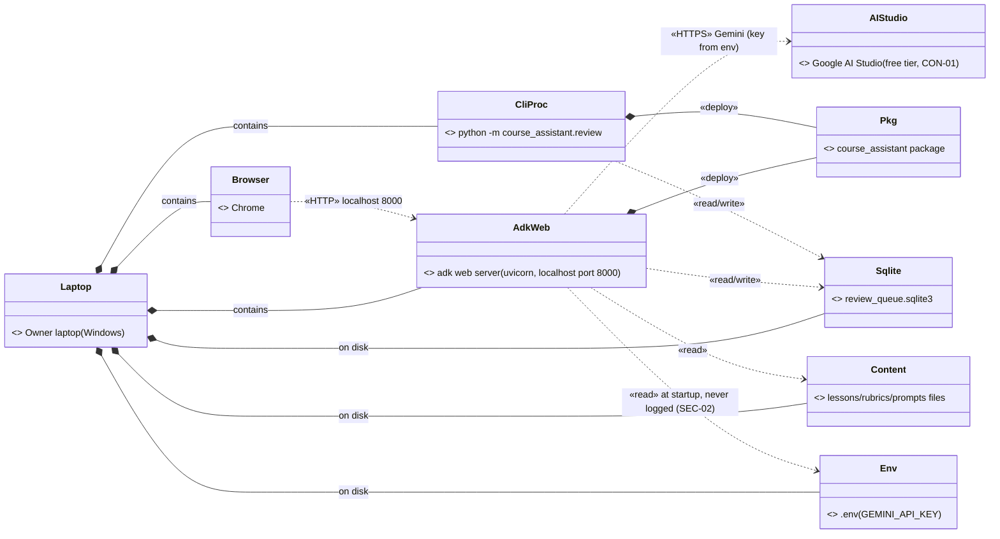
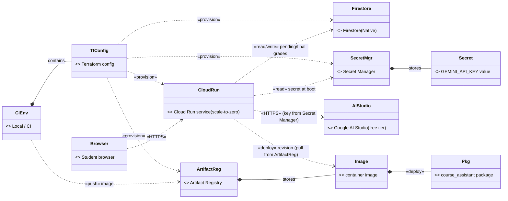

# Solution Design — Course Assistant

| Field | Value |
|---|---|
| Version | 0.2 (draft for owner approval) |
| Date | 2026-10-29 |
| Owner | Felipe Obando |
| Status | Draft — written after `docs/PROJECT_CHARTER.md` (approved 2026-10-29) and `docs/SRS.md` (approved 2026-10-29) |
| Notation | UML notation rendered with Mermaid; component and deployment views use `classDiagram` with UML stereotypes because Mermaid has no native component/deployment diagram. |

> This file answers **how**: module layout, class/data schemas, and the implementation-level view of the flows already specified in `docs/SRS.md` §4.2. If this file and the SRS disagree, the SRS wins (SRS is the source of truth for **what**; this file must be corrected, not the other way round).
> Every module below exists to satisfy specific requirement ids — the "Req" column on each table is the traceability link back to `docs/SRS.md` / `docs/BACKLOG.md`. A module with no requirement id is scope creep (CLAUDE.md rule 3) and should not be built.
> Where a design choice needs a decision the SRS does not make, it is **not** resolved here: it is listed in **§9 Design questions for the owner** (CLAUDE.md rule 2). This file introduces no new requirement.

### Changelog

**v0.4 (2026-10-30)** — Design questions §9 resolved by the owner (DQ1–DQ8 adopted as recommended; DQ9 stays open, C1/cloud-only, GCP remains roadmap). Each §9 item is tagged `[RESOLVED …]`; the inline diagram notes that previously said "not decided here" (§4.1 FR-15, §4.2 verbatim, §7.1 SQLite) now state the decision. Behavior-changing ones are mirrored in SRS v0.6 (FR-15 fail-safe, FR-34 collect-all, FR-40 persist-every-submission). No module layout or diagram structure changed.

**v0.3 (2026-10-30)** — Guardrails consolidated and the tutor-jailbreak gap closed, tracking SRS v0.5. New **§5.1 Guardrails — layered defense** names every anti-injection / anti-jailbreak control across both LLM surfaces and labels each enforced / measured / accepted-limitation. The §5 responsibility table gains a `tutor` fixed-role row (FR-16, SEC-08) and `jailbreak_eval.py`; §1 gains `tests/test_tutor_jailbreak.py`, `eval/jailbreak_eval.py` and `eval/datasets/jailbreak/`; the `tutor.py` entry notes its fixed-role instruction. No diagram semantics changed.

**v0.2 (2026-10-29)** — UML-correctness and SRS-consistency pass (self-review as staff engineer). The v0.1 diagrams were Mermaid flowcharts with UML-looking labels: the same `-->` meant "calls", "reads", "writes", "data flows" and "deploys", so no arrow carried a defined meaning. This revision gives every arrow one UML meaning and makes the determinism boundary visible on the diagrams themselves. Key changes:
- **Notation fixed.** Component (§2) and deployment (§7) views are now `classDiagram` with UML stereotypes (Mermaid has no native component/deployment diagram); relationships restricted to `..>` dependency, `..|>` realization, `-->` association, `*--` composition, `o--` aggregation, each labeled. Every diagram has a "How to read this" legend.
- **Sequence diagrams rebuilt** (§4) with activations, returns to the actual caller, `alt/opt/loop/critical` guards, an explicit **ADK Runner** and **Gemini API** participant, and the determinism boundary (code orchestrates; the model only proposes).
- **Class model corrected** (§3): behavior removed from association labels; composition where a part cannot exist alone; multiplicities fixed from the SRS (`Submission --> 0..1 GradeProposal`, `Submission --> 1 PolicyDecision`); `ProposedCriterionScore` split from `CriterionScore` (FR-42); enumerations added; a second class diagram added for eval data.
- **Package layout completed** (§1): `scripts/traceability.py`, CI workflow, versioned injection pattern list, an `eval/datasets/` home for every dataset, per-agent tool inventory, and a correction of the calibration-data facts.
- **New §6 activity diagram** in real execution order; **new Submission state machine**; **new §9 Design questions for the owner** (9 items).

**v0.1 (2026-10-29)** — First draft written after SRS approval.

---

## 1. Package layout

Extends the existing repo. `learning_coach/` (phase-1, EVD-07 evidence) is untouched except for the M1 fixes (FR-01..05). Everything below is new, under `course_assistant/`, `eval/`, `scripts/`, `tests/` and `.github/`. Files already created pre-approval (data, prompts, rubrics, policy config — allowed under CLAUDE.md rule 1) are marked **[existing]**; everything else is new, now unblocked by SRS approval.

```
course_assistant/
├── __init__.py
├── config.py                      # CON-02: model id (gemini-3.1-flash-lite), single source, no silent fallback (NFR-03)
├── content/
│   └── lessons/
│       ├── L1_variables_and_types.md ... L8_error_handling.md   # FR-10, FR-10a (not yet created — P2)
├── data/
│   ├── open_questions.yaml        # [existing] FR-30 question text, never imported by tutor tools (FR-14)
│   └── canaries.yaml              # FR-10b canary facts (not yet created — P2)
├── rubrics/
│   ├── Q-L3-01_v1.yaml            # [existing] FR-30, SEC-04
│   ├── Q-L4-01_v1.yaml            # [existing]
│   └── Q-L5-01_v1.yaml            # [existing]
├── prompts/
│   ├── coordinator_v1.md          # [existing] root agent instruction
│   ├── tutor_v1.md                # [existing] lesson_tutor instruction
│   ├── open_grader_v1.md          # [existing] open_grader instruction (collects answer, never scores)
│   ├── grader_v1.md               # [existing] direct model call inside grade_open_answer, not an agent instruction
│   └── reference_label_a_v1.md, reference_label_b_v1.md   # [existing] §7.1 reference pipeline, double pass
├── config/
│   ├── grading_policy.yaml        # [existing] policy constants: threshold, pass_mark, margin, allowed_flags (AIR-22 versioned)
│   └── injection_patterns_v1.yaml # FR-36 detector pattern list, versioned like a prompt (AIR-22, NFR-04) (not yet created — P5)
├── retrieval.py                   # FR-11, FR-13: search_lessons(query, k) — BM25 + content-term coverage, pure function
├── agents/
│   ├── __init__.py
│   ├── coordinator.py             # root LlmAgent; tools: start_quiz, submit_mcq, get_progress, get_submission_status; owns no decision logic
│   ├── tutor.py                   # lesson_tutor LlmAgent; tool: search_lessons; + citation_validator callback (FR-12, FR-15); fixed-role instruction, untrusted inputs delimited (FR-16, SEC-08)
│   └── open_grader.py             # open_grader LlmAgent; tools: list_open_questions, grade_open_answer; never computes a score itself
├── quiz.py                        # FR-20..22 (S): start_quiz, submit_mcq, get_progress — pure code, no LLM call
├── grading/
│   ├── __init__.py
│   ├── schemas.py                 # Pydantic models (§3 class diagram)
│   ├── grader.py                  # grade_open_answer(question_id, answer) — the one tool allowed to call grader_v1; pipeline orchestrator (§4.2)
│   ├── rubrics.py                 # rubric loader/lookup (pass_mark, margin, version) — FR-30, FR-34
│   ├── validator.py               # FR-30a, FR-33: schema/range/evidence-quote checks → GradeProposal | GraderError
│   ├── injection.py               # FR-36: deterministic pattern-list detector, reads injection_patterns_v1.yaml
│   ├── policy.py                  # FR-34, FR-34a, FR-34b, FR-35: publication_policy(...) → PolicyDecision, pure, fail-closed
│   └── baseline.py                # FR-37: keyword_baseline(question_id, answer), frozen match→score rule (OD-08)
├── review/
│   ├── __init__.py
│   ├── store.py                   # FR-40: ReviewStore interface + SQLite impl; single conditional write for immutability (FR-44, FR-34c)
│   └── cli.py                     # FR-41: python -m course_assistant.review list|show|confirm|correct
└── status.py                      # FR-43, FR-43a: submission_id mint + status lookup (no-auth demo identifier)

eval/
├── data_generation/
│   ├── answers_Q-L3-01.prompt.md  # [existing]
│   └── answers_Q-L5-01.prompt.md  # [existing]
├── datasets/                      # one home for every AIR-01..06 dataset (see note below)
│   ├── calibration_answers_Q-L4-01.json   # [existing, to be MOVED here from repo root] AIR-01, 26 answers
│   ├── reference_labels/          # AIR-01 double-pass labels, label_provenance=llm_reference
│   ├── grounding/                 # AIR-02: in/out-of-scope + canary questions, answer_markers, expected chunk ids
│   ├── integrity/                 # AIR-03: answer-key-leak prompts + expected leaked phrases
│   ├── injection/                 # AIR-04: attacks + clean twins + held-out (no-pattern) attacks
│   ├── jailbreak/                 # AIR-03a: tutor jailbreak attacks (role override, hidden-data extraction, grounding-disable) + held-out
│   ├── fairness/                  # AIR-05: name-swap + L2 pairs + noise-control pairs
│   └── multiturn/                 # AIR-06: multi-turn sessions
├── reference_labels.py            # §7.1: double-pass reference pipeline
├── calibration.py                 # AIR-10..13, AIR-12a: dev/holdout run, retention rule, Wilson intervals (uses grader AND baseline)
├── fairness.py                    # AIR-05, AIR-17: name-swap + L2 pairs + noise control
├── injection_eval.py              # AIR-04, AIR-16: injection set run, detector bypass vs policy gate
├── integrity_eval.py              # AIR-03, AIR-15: answer-key leak checks
├── grounding_eval.py              # AIR-02, AIR-14, AIR-14a, AIR-14b: in/out-of-scope, ablation, canary
├── jailbreak_eval.py              # AIR-03a, AIR-15a: tutor red-team (stay-in-role, hidden-data leak=0, off-syllabus listing)
└── reports/                       # AIR-22 stored reports — COMMITTED JSON (recommended; see DQ2)

scripts/
└── traceability.py                # M10, EVD-09: fails CI if a Must requirement has no test/artifact (BACKLOG §3)

.github/
└── workflows/
    └── ci.yml                     # M10: offline tests (NFR-02) + traceability gate

tests/                             # flat names per BACKLOG §3 (see DQ3); every file tagged @pytest.mark.req("FR-xx")
├── test_phase1_fixes.py           # FR-01..05
├── test_retrieval.py              # FR-10, FR-10a, FR-11..15
├── test_tutor.py                  # FR-12, FR-15
├── test_canaries.py               # FR-10b
├── test_tutor_ablation.py         # AIR-14a (stub wiring, fixture)
├── test_tutor_jailbreak.py        # FR-16, SEC-08, AIR-03a (offline wiring + untrusted-input delimiting, fixture)
├── test_quiz.py                   # FR-20..22
├── test_grader_schema.py          # FR-30a, FR-31, FR-33
├── test_policy.py                 # FR-34, FR-34a, FR-34b, FR-35 (one test per fail-closed input)
├── test_review_queue.py           # FR-40..43, SEC-03
├── test_final_grade_immutability.py  # FR-44, FR-34c
├── test_import_boundary.py        # FR-14, SEC-04, SEC-01, SEC-05
├── test_env_handling.py           # SEC-02
└── test_multiturn.py              # AIR-06
```

**Calibration-data facts (corrected from v0.1).** `calibration_answers_Q-L4-01.json` (26 answers, `question_id: Q-L4-01`, content about why a function returns None) **already exists at the repo root** and is valid data for Q-L4-01; it should be **moved to `eval/datasets/`**. Data-generation prompts exist for **Q-L3-01 and Q-L5-01** (`eval/data_generation/answers_Q-L3-01.prompt.md`, `answers_Q-L5-01.prompt.md`), but **no valid answers exist for those two questions yet**. The file `calibration_answers_Q-L3-01.json` currently at the repo root is a **stale duplicate**: its `question_id` is relabeled to `Q-L3-01` but its answer bodies are the Q-L4-01 "returns None" answers, which do **not** match the Q-L3-01 question ("difference between a for loop and a while loop"). It must not be used as calibration data and should be deleted/regenerated from `answers_Q-L3-01.prompt.md` (IDs start at A-027). This is an eval-data integrity note, not a licence to "fix" labels (CLAUDE.md evaluation-integrity rules): the correct action is to regenerate, not to edit.

**Not yet created, blocking P2 per BACKLOG M2:** `content/lessons/*.md` (8 files), `data/canaries.yaml`, valid calibration answers for Q-L3-01 and Q-L5-01. These are data/doc gaps, not design gaps — flagged here so a phase doesn't start with an unnoticed hole.

`pyproject.toml` currently packages only `learning_coach*` (per CLAUDE.md commands note) — it must add `course_assistant*` before `pip install -e ".[dev]"` picks up any of the above.

---

## 2. Component view

UML component diagram of the code that implements `docs/SRS.md` §4.2.1. Rendered as a `classDiagram`: each class is a «component», an «interface», an «artifact» (prompt/rubric/policy/SQLite file) or an «external» system. The determinism boundary is on the diagram: every component carries `<<llm>>` or `<<deterministic>>`.



**How to read this.** `..>` = dependency (client → thing it uses), labeled with the operation or a `«stereotype»`; `..|>` = realization (a class implements an «interface»). There is no association/composition in this view — components hold no persistent references to each other, only runtime dependencies. `<<llm>>` vs `<<deterministic>>` is the determinism boundary (SRS §4.1): only the four `<<llm>>` components call the model. Note that **`Policy` depends on nobody** except reading `grading_policy.yaml`: the grader scans with `Injection` and passes the resulting flags *into* `Policy`; the policy never calls the detector, the grader, the validator or the store. `Baseline` is used only by `Calibration`, never by the grader. The three «interface» seams (`ModelClient`, `Retriever`, `ReviewStore`) are what the evaluation swaps: `FakeModelClient` for offline tests (NFR-02), `EmptyRetriever` for the AIR-14a ablation, `FirestoreStore` only for C1.

---

## 3. Data model — class diagrams

Implements `docs/SRS.md` §11 as Pydantic models (ADK 2.13.0 uses Pydantic for `output_schema`). Validation rules are enforced in `grading/validator.py`, not in the field types, where the SRS requires a specific error path (`grader_error` as **data**, FR-33) rather than an exception at construction time.

### 3.1 Domain model



**How to read this.** `*--` = composition (the part cannot exist without the whole: a `Criterion` only exists inside its `Rubric`; a `ProposedCriterionScore` only inside its `GradeProposal`; a `CriterionScore` only inside its `FinalGrade`). `-->` = directed association with multiplicity (a structural reference that persists), with a role name, never a verb. `<<enumeration>>` classes replace the free-string fields of §11. There is no behavior on any edge.

Design decisions tying this to the SRS (not new requirements):
- **Multiplicities (SRS).** `Submission --> "0..1" GradeProposal`: FR-34a (`too_short`) and FR-34b (infra failure) produce a submission with **no** proposal. `Submission --> "1" PolicyDecision`: every submission gets a decision, including the `too_short` one that has no proposal — so the decision belongs to the submission, not to the proposal; `PolicyDecision --> "0..1" GradeProposal`. `Submission --> "0..1" FinalGrade`: pending-but-unreviewed submissions have none. There is a single path to `FinalGrade`; *how* it got there (auto vs teacher) is recorded in `source`, not drawn as two edges.
- **`ProposedCriterionScore` ≠ `CriterionScore` (FR-42).** The LLM proposal carries `evidence_quote` and `rationale`; a teacher correction carries only `criterion_id` + `score` (the original evidence/rationale stay on the retained proposal, FR-42). Reusing one class would wrongly imply a teacher invents evidence.
- **`validate()` returns data, not an exception (FR-33).** `GradeProposal | GraderError`. `GraderError.reason` is a `ReviewReason`, so a schema failure routes to REVIEW like any other reason.
- **`total` is never on `GradeProposal`.** It is `sum(per_criterion.score)`, computed by code on `FinalGrade` only (FR-31a). The proposal has no total to trust.
- **`MCQ.key` has no UML `-` visibility.** FR-14/SEC-04 is a *module import boundary* (quiz data not importable from `agents/tutor.py`), not class-level encapsulation. That boundary is a dependency constraint shown in §2 / enforced by `tests/test_import_boundary.py`, not a `-` on this class.
- **Type consistency.** A rubric is referenced everywhere by the string `rubric_ref` of the form `"Q-L4-01_v1"` (file-version identity), including `GradeProposal.rubric_version` and the FR-40 queue field. v0.1's `int version` on `Rubric` vs `str rubric_version` on `GradeProposal` is resolved to the single string form. (The SRS §11 does not fix the representation; this is a design choice, see DQ3 note is not needed — it contradicts nothing.)

### 3.2 Evaluation-data model



**How to read this.** `-->` = directed association with multiplicity (each answer carries one or more per-criterion reference labels). `Report` has no edges here: it is the AIR-22 metadata envelope stamped on every stored report (`run_mode` ∈ {`live`, `fixture`}; `label_provenance` ∈ {`llm_reference`, `llm_generated`}, never `human`). `ReferenceLabel.uncertain = (score_a != score_b)` marks a double-pass disagreement excluded from the retention gate (AIR-01).

---

## 4. Sequence diagrams (implementation level)

These add module/function names to the conceptual flows in `docs/SRS.md` §4.2.2–§4.2.3. ADK detail that matters for the determinism boundary: agents do **not** message the student — the **Runner** delivers messages to agents and events back to the student, and executes the tool/transfer *function calls the model returns*. The **Gemini API** is a participant because *where the model is called* is the whole point.

### 4.1 Ask the tutor (FR-11..15)

```mermaid
sequenceDiagram
    actor Student
    participant Runner as ADK Runner / Dev UI
    participant Coord as coordinator
    participant Tutor as lesson_tutor
    participant Gemini as Gemini API
    participant Retr as retrieval.search_lessons
    participant State as tool_context.state
    participant Cite as citation_validator (after_agent_callback)

    Student->>+Runner: message
    Runner->>+Coord: run(message)
    Coord->>+Gemini: route? (instruction + history)
    Gemini-->>-Coord: function_call transfer_to_agent(lesson_tutor)
    Coord-->>-Runner: event: transfer
    Runner->>+Tutor: run()
    Tutor->>+Gemini: turn 1 (tutor instruction)
    Gemini-->>-Tutor: function_call search_lessons(query, k)
    Tutor-->>-Runner: event: tool_call
    Runner->>+Retr: search_lessons(query, k=5)
    Retr->>Retr: BM25 > 0 AND >= 2 content terms (FR-13)
    Retr->>State: write retrieved_chunk_ids
    Retr-->>-Runner: [] or [Chunk, ...]
    Runner->>+Tutor: tool_result(chunks)
    alt [chunks empty]
        Tutor->>+Gemini: turn 2 (no chunks)
        Gemini-->>-Tutor: TutorAnswer {covered=false, cited_chunk_ids=[]}
    else [chunks returned]
        Tutor->>+Gemini: turn 2 (chunks as context)
        Gemini-->>-Tutor: TutorAnswer {answer, cited_chunk_ids, covered}
    end
    Tutor-->>-Runner: final response (TutorAnswer)
    Runner->>+Cite: after_agent_callback(TutorAnswer)
    Cite->>State: read retrieved_chunk_ids
    Cite->>Cite: cited_chunk_ids subset of retrieved ? (FR-15)
    opt [cited not subset of retrieved]
        Cite->>Cite: log + count violation (FR-15)
    end
    Cite-->>-Runner: callback returns
    Runner-->>-Student: events (answer); on invalid citation: fail-safe suppress/refuse (FR-15, DQ4 resolved)
```

**How to read this.** `->>` = call (activates the receiver, shown by the bar); `-->>` = return to the caller that made the matching call; `alt/opt` = guarded fragments with the guard in `[brackets]`. The model call is always `Tutor/Coord ->> Gemini`; the Runner — not the tutor — runs `search_lessons` and the citation callback. `search_lessons` writes the retrieved ids into `tool_context.state`; the callback reads them back (the two never message each other directly). FR-15 now **fails safe** (DQ4 resolved, SRS v0.6): an invalid-cited answer is suppressed or the tutor refuses, then the violation is logged and counted — the student never sees it.

### 4.2 Submit and grade an open answer (FR-30..37) — the core evaluation pipeline

`grade_open_answer` is the explicit **orchestrator**: it calls, in order, `status.mint_submission_id` → `too_short` check → rubric lookup → `injection.scan` → `ModelClient` (Gemini) → `validator.validate` → `policy.decide` → `store.insert_pending` or `store.write_final`. The **policy is a pure function** (proposal-or-error, flags, length, rubric → `PolicyDecision`); it never calls the store.



**How to read this.** `critical` wraps the whole pipeline (the whole thing either completes or the FR-34b branch catches an infra failure). Every `-->>` returns to the caller that invoked it: `Pol` and `Val` return to `Grader` (their caller), never to `Student`; `Pol` never messages `Store`. Rubric lookup happens **before** the model call (the prompt needs the criteria) **and** before validation (it needs the criterion ids). The **verbatim-answer risk** — `open_grader` is an LLM and could paraphrase the student before calling the tool — is surfaced as a `before_tool_callback` that compares the `answer` argument against the user's last message in the invocation context; on mismatch it **substitutes** the arg with that verbatim message and logs the mismatch (DQ5 resolved), so the graded text is always the student's own.

### 4.3 Teacher review (FR-40..45)



**How to read this.** `Store` returns to the `CLI` (its caller), then the `CLI` to the `Teacher` — the store never messages the teacher directly. Immutability is a **single conditional write**, not check-then-write: `write_final(...) ... WHERE status='pending'` updates in one transaction and returns `success` or `already_final` from the affected-row count, so two concurrent writers cannot both pass a prior check (FR-44, FR-34c). `show(submission_id)` is a real `get(...)` returning the record, not a status question.

### 4.4 Submission lifecycle (state machine, FR-42/FR-44/FR-34a/FR-34b/FR-34c)

The SRS §4.2.4 diagram is the conceptual lifecycle; at implementation level the `Proposed` state does not always exist (FR-34a/FR-34b create a `Pending` submission with no proposal). This is the state machine for `Submission.status`.

```mermaid
stateDiagram-v2
    [*] --> Pending : submitted [len < 10] / reasons=[too_short]
    [*] --> Pending : grade_failed [infra error after retries] / reasons=[infra_error], no proposal
    [*] --> Pending : graded [decision = REVIEW] / insert_pending(proposal)
    [*] --> Final : graded [decision = PUBLISH] / write_final(auto_published)
    Pending --> Final : confirm / write_final(teacher_confirmed)
    Pending --> Final : correct [scores in 0..2] / total=sum(scores); write_final(teacher_corrected)
    Final --> [*]

    note right of Final
        Immutable (FR-44, FR-34c). A confirm/correct on a Final record
        is rejected by the conditional write (WHERE status='pending')
        and does NOT transition — Final has no outgoing edge.
    end note
```



**How to read this.** Transitions are `event [guard] / action`. `Final` is a terminal state with no outgoing transition; the FR-34c rejected attempt is an internal no-op (the note), not an edge.

---

## 5. Module responsibility and determinism table

Every row maps to §4.1's boundary and names the file, so the *requirement → file* mapping is explicit.

| Module | Owns | Decision owner | Req |
|---|---|---|---|
| `retrieval.py` | Chunk ranking + coverage gate | Code | FR-11, FR-13 |
| `agents/tutor.py` | Answer wording — **instructed to use retrieved chunks; grounding measured by AIR-14/14a/14b**, not enforced | LLM | FR-12 |
| `agents/tutor.py` (`citation_validator`) | Citation validity (cited ⊆ retrieved) | Code | FR-15 |
| `agents/tutor.py` (fixed-role instruction) | Resistance to role/instruction manipulation; user + chunk text delimited as untrusted — **measured (AIR-15a), not enforced** | LLM (instructed) / Code (eval + import boundary) | FR-16, SEC-08 |
| `quiz.py` | MCQ scoring, attempt limits, progress | Code | FR-20..22 |
| `status.py` | `submission_id` mint + status lookup (no-auth demo id) | Code | FR-43, FR-43a |
| `grading/grader.py` | Pipeline orchestration + the one model call for a proposal | LLM (proposes) / Code (orchestrates) | FR-31, FR-34b |
| `grading/rubrics.py` | Rubric load/lookup (pass_mark, margin, version) | Code | FR-30, FR-34 |
| `grading/validator.py` | Schema/range/evidence-quote checks → `GradeProposal \| GraderError` | Code | FR-30a, FR-33 |
| `grading/injection.py` | Pattern-list flag (signal only) | Code | FR-36 |
| `grading/policy.py` | PUBLISH vs REVIEW, fail-closed, **pure (no store call)** | Code | FR-34, FR-34a, FR-34b, FR-35 |
| `grading/baseline.py` | Keyword-match score (comparison only, never routes) | Code | FR-37 |
| `review/store.py` | Review-queue persistence; **single conditional write** for immutability | Code | FR-40, FR-44, FR-34c |
| `review/cli.py` | Final grade on pending items (confirm/correct) | **Human teacher** (code enforces immutability) | FR-41..45 |
| `ModelClient` seam (`GeminiClient` / `FakeModelClient`) | Model access; `Fake` keeps offline tests network-free | Code | NFR-02, NFR-03 |
| `Retriever` seam (`BM25Retriever` / `EmptyRetriever`) | Retrieval; `Empty` is the ablation stub | Code | FR-11, AIR-14a |
| `ReviewStore` seam (`SqliteStore` / `FirestoreStore`) | Persistence; Firestore only for C1 | Code | FR-40, CON-01 |
| `eval/reference_labels.py` | Calibration ground truth (self-consistency, not independent) | LLM (×2 passes) | §7.1, AIR-01 |
| `eval/calibration.py`, `fairness.py`, `injection_eval.py`, `integrity_eval.py`, `grounding_eval.py`, `jailbreak_eval.py` | Dataset runs + reports (AIR-22 metadata) | Code | AIR-10..22, AIR-03a, AIR-15a |
| `scripts/traceability.py` | CI gate: every Must has a test/artifact | Code | M10, EVD-09 |

No `agents/*.py` module may import `rubrics/`, `data/open_questions.yaml`, or `data/canaries.yaml` — this import boundary is a test (`tests/test_import_boundary.py`, SEC-04), shown in §2 as the absence of a tutor→answer-key dependency.

### 5.1 Guardrails — layered defense (both LLM surfaces)

One place that names every guardrail against prompt injection and jailbreaks, across the **two** LLM surfaces (the `lesson_tutor` and the grader's one model call), and whether each is **enforced** (a test fails if broken), **measured** (a report number, never claimed to be zero) or an **accepted limitation**. The attacker is the student; the target is either the grade (grader) or the tutor's role/hidden data (tutor). The ordering principle is the determinism boundary of §4.1: **the LLM is never the last line of defense** — a deterministic gate or a human sits behind it.

| Layer | Tutor surface | Grader surface | Kind | Req |
|---|---|---|---|---|
| **1. Input as data, not instruction** | user message + retrieved chunk text are delimited, never obeyed as instructions | student answer is delimited untrusted data | enforced (prompt template; `test_tutor_jailbreak.py` / inspection) | SEC-08, FR-16 / SEC-05, FR-32 |
| **2. Secrets unreachable** | tutor tools cannot import rubrics/keys/canaries | — | enforced (`test_import_boundary.py`) | SEC-04, FR-14 |
| **3. Deterministic signal** | — (no detector; the jailbreak eval is the honest check) | pattern-list detector adds a flag — **signal only** | enforced (detector) + measured (bypass rate, AIR-16) | FR-36 |
| **4. Deterministic gate, fail-closed** | citation check (cited ⊆ retrieved); refusal when no chunk qualifies (FR-13) | `publication_policy`: any flag / low-confidence / borderline / error → REVIEW, never PUBLISH by default | enforced (`test_policy.py`, FR-15 callback) | FR-13, FR-15 / FR-34, FR-35 |
| **5. Human in the loop** | tutor has **no grade authority** (reference surface only) | pending grades go to the teacher CLI before the student sees a score | enforced (queue + `test_review_queue.py`) | — / FR-40..43 |
| **6. Immutability / no agency** | — | no agent tool can set, edit or delete a final grade; single conditional write | enforced (`test_final_grade_immutability.py`, SEC-03) | FR-44, SEC-03 |
| **Adversarial measurement** | AIR-03a jailbreak set (held-out cases) → AIR-15a: stay-in-role rate, hidden-data leaks = 0 w/ Wilson, off-syllabus listed | AIR-04 injection set (clean twins + held-out) → AIR-16: detector bypass **separate** from gate | measured (reports, EVD-05 grader / EVD-11 tutor) | AIR-03a/15a / AIR-04/16 |

**How to read this.** "Enforced" = a test turns red if the property breaks. "Measured" = a report number with a Wilson interval; the honesty rule (`PROJECT_CHARTER.md` §1.4) forbids reporting it as zero or "proved." The single most important design decision is layer 3→4: **the injection detector is a signal the gate consumes, never the gate itself** (§2: `Policy` depends on nobody but its config; the grader scans with `Injection` and passes the flags *into* the pure policy). A novel jailbreak that slips past the detector (grader) or past the tutor's instruction (tutor) is still caught by layer 4/5 for the grade path, and for the tutor is **reported, not blocked** — grounding is measured, not enforced (§4.1.1), because the model's own knowledge cannot be removed. That residual is R2 (grader) and R8 (tutor) in `docs/RISK_REGISTER.md`. The held-out cases in AIR-04/AIR-03a exist so neither the detector nor the tutor instruction is graded on its own homework.

**Why only two of the four LLM surfaces carry a jailbreak dataset (EVD-11).** The system has four LLM surfaces (§2): `coordinator`, `lesson_tutor`, `open_grader`, and the `grader_v1` model call inside `grade_open_answer`. Red-teaming is scoped to **what a compromised agent could actually steal or break**, not applied uniformly for appearance:

| Surface | What a jailbreak could gain | Coverage |
|---|---|---|
| `grader_v1` (grading call) | manipulate the grade | **measured** — AIR-04/AIR-16 (EVD-05) |
| `lesson_tutor` | leak rubrics/keys/canaries/system prompt; answer off-syllabus | **measured** — AIR-03a/AIR-15a (EVD-11) |
| `coordinator` | nothing: routes + deterministic tools, owns no decision logic, holds no secret (SEC-04 import boundary); worst case is a misroute, bounded by §4.1 | **contained by design** — determinism + import boundary, no dataset |
| `open_grader` (agent) | nothing: its tools (`list_open_questions`, `grade_open_answer`) never return rubric criteria to the agent; the answer is passed verbatim (DQ5 callback) and graded as delimited data | **contained by design** — import boundary + verbatim callback, no dataset |

A jailbreak dataset for the bottom two would be **filler coverage** — it would exercise agents with no secrets and no grade authority and report a reassuring number that measures nothing. The honest claim (EVD-11) is that their compromise is bounded by the determinism boundary (§4.1: code and the human decide, never the LLM) and the import boundary (SEC-04), which is an argument to explain, not a test to fake (honesty rule, NFR-07).

---

## 6. Error and fail-closed paths

UML activity diagram (Mermaid flowchart syntax), in **real execution order**: `too_short` → rubric lookup → injection scan → model call (bounded retry) → validation → policy checks. One initial node, two final nodes (PUBLISH, REVIEW), one merge. **Design decision shown (recommended, see DQ6): the policy collects all failing reasons rather than short-circuiting**, because `PolicyDecision.reasons` is a list and AIR-13 reporting benefits from the complete set. Every reason in a leaf is a member of the `ReviewReason` enumeration (§3).



**How to read this.** `((•))` = initial node; `([...])` = final nodes; the empty circle `(( ))` labelled **M** = merge where every REVIEW path rejoins. Guards are in `[brackets]`/on the decision edges. The injection detector's flag merges into `flags` **before** the policy's "any flag?" check (shown at node `S`, consumed at node `P`). `too_short`, `rubric_lookup_failed` and `infra_error` are structural early exits (no proposal exists to check further); the four proposal-level reasons are collected together inside the policy node. Leaves use only `ReviewReason` members.

---

## 7. Deployment and infrastructure architecture

Two topologies in priority order. **The Must is local** — `adk web` + local SQLite + Gemini via AI Studio (NFR-01, CON-01). GCP is **C1, a "Could" and the first item in the cut order** (`PROJECT_CHARTER.md` §3): designed here, may not be built; if it isn't, this is the EVD-10 roadmap artifact, not a claim of something running. Both are UML deployment diagrams rendered as `classDiagram` with stereotypes.

### 7.1 Primary topology — local (the demo that actually runs)



**How to read this.** Classes are **nodes** (`«device»`, `«executionEnvironment»`, `«external»`) or **artifacts** (`«artifact»`); `*--` nests an artifact/process into a node (it is deployed/hosted there); `..>` between nodes is a communication path labeled with its protocol, and `..>` to an artifact is a `«read»`/`«read/write»` access. Artifacts never "call" each other.

**Concurrency consequence (made visible).** The `adk web` process and the teacher CLI are two processes sharing one SQLite file (`review_queue.sqlite3`). The design uses **WAL journal mode** plus the single conditional write of §4.3 so the two processes do not corrupt the queue or double-finalize a grade. (DQ8 resolved: WAL + single conditional write; the conditional write is the portable guarantee, realized as a transaction precondition in `FirestoreStore` for C1.)

### 7.2 Optional cloud topology — GCP (C1, free-allotment only, Terraform-managed)

Same application artifact redeployed, not a rewrite. Hard constraints: **Cloud Run + Firestore + Secret Manager + Artifact Registry within free allotments; no Vertex AI, no Cloud SQL** (CON-01). The model is still Gemini via AI Studio (CON-02).



**How to read this.** Same legend as §7.1. Artifact Registry and Secret Manager are **service nodes**; the **container image** and the **secret value** are the artifacts they hold. Firestore is an `«executionEnvironment»` service node (not a `«datastore»` — that is not a UML stereotype). Terraform draws a `«provision»` dependency to **each** resource, not to a cloud blob.

| Decision | Rationale | Req |
|---|---|---|
| Cloud Run (not GKE/VM) | Scale-to-zero stays in free allotment; one container, no cluster | CON-01, NFR-07 |
| Firestore Native (not Cloud SQL) | Cloud SQL banned; free tier; maps onto the `review_queue` shape | CON-01, FR-40 |
| Secret Manager for the API key | Key never baked into image/plaintext env | SEC-02 |
| Artifact Registry | Free-tier image store; CI pushes, Cloud Run deploys a revision | CON-01 |
| Gemini via AI Studio, not Vertex | CON-01 bans Vertex; CON-02 pins the model | CON-01, CON-02 |
| Terraform only; owner runs `apply` | Reviewable infra-as-code; no click-ops; agent never applies | CON-03 |

**Open gaps for C1 (not silently resolved):** who talks to Firestore for the teacher review queue (the CLI is local and talks to SQLite), and the invoker-auth setting on the public Cloud Run URL — see **DQ9**.

**Persistence seam.** `review/store.py` exposes the narrow `ReviewStore` interface (`insert_pending`, `get`, `list_pending`, `write_final`) with `SqliteStore` for the Must and `FirestoreStore` for C1 (§2, §3). Policy, CLI and status depend on the interface, so C1 is a store swap plus Terraform, not an application change — the single seam that keeps C1 cuttable.

**Deliberately NOT in either topology:** no load balancer/CDN/custom domain, no authentication (FR-43a — accepted demo limitation), no VPC, no autoscaling tuning, no multi-region, no Vertex, no managed vector DB (retrieval is in-process BM25, FR-11). These are roadmap (`PROJECT_CHARTER.md` §6), not gaps.

---

## 8. Out of scope for this document

Why the project exists, EVD claims, MoSCoW scope, delivery phases, limitations: `docs/PROJECT_CHARTER.md`. Testable requirements: `docs/SRS.md`. Stories, Gherkin, traceability: `docs/BACKLOG.md`. This file introduces no new requirement; a design choice that would imply one is listed in §9, not silently resolved (CLAUDE.md rule 2).

---

## 9. Design questions for the owner

Each item: the question · the requirement it touches · recommendation · what changes if the answer differs. **Status: DQ1–DQ8 resolved by the owner on 2026-10-30 (all adopted as recommended); DQ9 remains open (C1/cloud-only, GCP stays roadmap).** Behavior-changing resolutions are recorded in the SRS v0.6 changelog (FR-15, FR-34, FR-40).

1. **[RESOLVED 2026-10-30 — approved; SRS header now `0.6 (approved)`.]** **SRS header version/status mismatch.** The SRS header reads "Version 0.4 (draft for owner approval)" while its Status row reads "Approved 2026-10-29." · *touches:* SRS provenance, CLAUDE.md "SRS approved" gate. · *Recommendation:* treat it as approved (the Status row and changelog are explicit) and change the header label to "0.4 (approved)" in the SRS — **I did not edit the SRS** (CLAUDE.md: do not touch it without approval). · *If different (still a draft):* code is not yet unblocked; this design doc stays "draft, pending SRS finalization" and no §1 code file may be created.

2. **[RESOLVED 2026-10-30 — commit `eval/reports/*.json`; keep `/eval/results/` and `results.json` ignored.]** **Reports committed or ignored.** v0.1 left `eval/reports/` as "gitignored or committed — TBD." EVD artifacts must be committed to count as evidence; `.gitignore` currently ignores `/eval/results/` and `results.json` (ADK `learning_coach` run outputs), **not** `eval/reports/`. · *touches:* AIR-20, AIR-22, EVD-02/03/09. · *Recommendation:* **commit** `eval/reports/*.json` (they are the evidence), keep `/eval/results/` and `results.json` ignored. · *If different (ignore them):* the EVD claims lose their stored artifact and `scripts/traceability.py` must treat a report as present-only-in-CI, weakening the evidence story.

3. **[RESOLVED 2026-10-30 — adopt the BACKLOG flat test names (done in §1).]** **Test file path convention.** v0.1 used `tests/test_course_assistant/...`; BACKLOG §3 names flat files (`tests/test_policy.py`, `tests/test_retrieval.py`, …). · *touches:* BACKLOG §3 traceability rows. · *Recommendation:* adopt the **BACKLOG flat names** (done in §1) so the traceability table resolves without a path rewrite. · *If different (nested package):* BACKLOG §3 test paths must be updated in lockstep, or `traceability.py` will not find them.

4. **[RESOLVED 2026-10-30 — fail safe: suppress the invalid-cited answer / refuse, then log+count. SRS FR-15 updated (v0.6).]** **What the student sees on a citation violation (FR-15).** FR-15 says only "logged and counted." · *touches:* FR-15; flagged in the SRS review as a fail-open risk. · *Recommendation:* **fail safe** — on `cited ⊄ retrieved`, suppress the cited claim / show the refusal, and log+count; do not show an answer with invalid citations. · *If different (show anyway):* the tutor can present an uncited/invalid-cited answer, which is a fail-open path and should be stated as a limitation in `PROJECT_CHARTER.md` §6. Either way it is **not** decided in the diagram.

5. **[RESOLVED 2026-10-30 — `before_tool_callback` **substitutes** the `answer` arg with the student's verbatim last message and logs any mismatch (not compare-and-reject).]** **Verbatim answer delivery to `grade_open_answer` (FR-32, FR-31).** `open_grader` is an LLM and could paraphrase the student before calling the tool; the SRS requires the graded text to be the student's own (evidence-substring check, FR-33). · *touches:* FR-31, FR-32, FR-33, CLAUDE.md "text graded must be exactly what the student wrote." · *Recommendation:* a `before_tool_callback` that **substitutes** the `answer` argument with the user's verbatim last message from the invocation context (and logs any mismatch). · *If different (compare-and-reject):* a mismatch routes to REVIEW instead of being corrected; simpler to reason about but surfaces more REVIEWs. Must be implemented one way or the other — not left to the model.

6. **[RESOLVED 2026-10-30 — collect all failing reasons (drawn that way in §6). SRS FR-34 updated (v0.6).]** **Policy short-circuit vs collect-all reasons (FR-34, AIR-13).** `PolicyDecision.reasons` is a list. · *touches:* FR-34, AIR-13 reporting. · *Recommendation:* **collect all** proposal-level reasons (drawn that way in §6); better for AIR-13 and the teacher CLI. `too_short`/`infra_error`/`rubric_lookup_failed` remain structural early exits (no proposal to inspect). · *If different (short-circuit on first failure):* `reasons` holds at most one entry and §6 collapses to a chain; AIR-13 then cannot report co-occurring causes.

7. **[RESOLVED 2026-10-30 — persist every submission (row at accept, updated to `final` on PUBLISH/teacher). SRS FR-40 updated (v0.6).]** **Are all submissions persisted?** FR-40 says "pending items persist," but FR-43 status lookup and the FR-42 PUBLISH write both need the submission stored even when PUBLISHed. · *touches:* FR-40, FR-42, FR-43, FR-43a. · *Recommendation:* **persist every submission** (one row at accept time, updated to `final` on PUBLISH or teacher action), so §3's `Submission --> 1 PolicyDecision` and `--> 0..1 FinalGrade` hold and status lookup always finds a row. · *If different (persist pending only):* a PUBLISHed submission has no queryable status row, contradicting FR-43; the data model and §4.2 store writes would need to change.

8. **[RESOLVED 2026-10-30 — WAL mode + the single conditional write of §4.3. The conditional write is the **portable** immutability guarantee: `SqliteStore` uses WAL locally; `FirestoreStore` realizes the same guarantee as a transaction with a `status='pending'` precondition for C1. GCP stays roadmap.]** **SQLite concurrency between the two processes.** `adk web` and the CLI share one file. · *touches:* FR-44, NFR-07, §7.1. · *Recommendation:* **WAL mode + the single conditional write** of §4.3. · *If different (no WAL / separate stores):* risk of "database is locked" errors or a split source of truth; immutability guarantee (FR-44) would need another mechanism.

9. **[OPEN — C1/cloud-only; revisit if/when GCP is built. GCP remains design/roadmap (owner, 2026-10-30), so this does not block the local Must.]** **Teacher access and invoker auth in C1 (CON-01, SEC-07).** In the cloud topology nobody yet reaches the review queue (the CLI is local/SQLite), and an unauthenticated Dev UI on a public Cloud Run URL would let anyone spend the free-tier quota behind the Gemini key. · *touches:* CON-01, SEC-02, SEC-07, FR-41. · *Recommendation:* for C1, **no `allUsers` invoker — IAM-authenticated only**, and run the teacher review as an IAM-gated path (a second authenticated Cloud Run route or a `gcloud`-run admin job against Firestore), not the local CLI. · *If different (public demo):* document the quota/abuse exposure explicitly as an accepted C1 limitation; it must not be left implicit.
